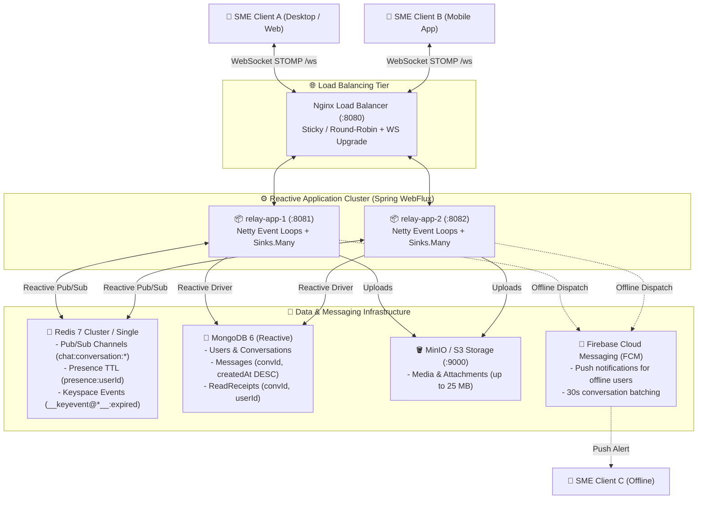
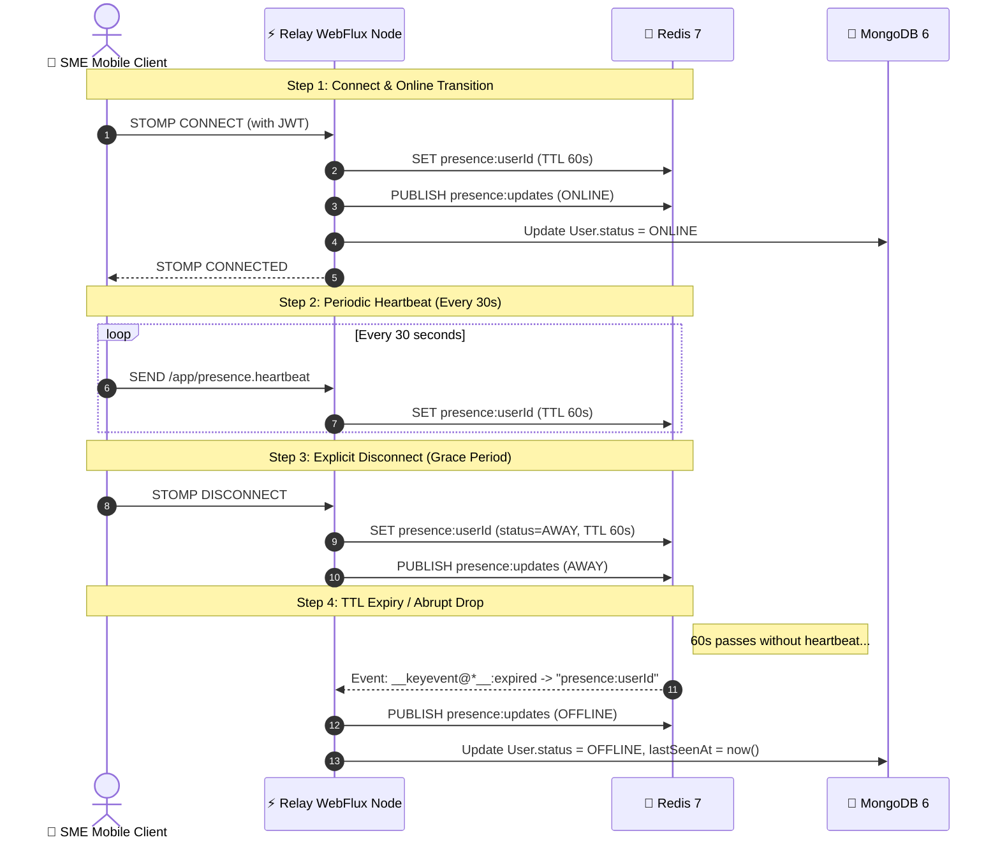

# ⚡ Relay Messaging

> **Scalable Real-Time Messaging Backend for Kenyan SMEs**  
> Built with **Spring Boot 3 (WebFlux, Reactive)**, **STOMP over WebSocket**, **Redis 7 (Pub/Sub & Presence)**, **MongoDB 6**, **Firebase Admin SDK (FCM)**, and **Docker Compose**.

[](https://openjdk.org/)
[-brightgreen.svg)](https://spring.io/projects/spring-boot)
[](https://spring.io/projects/spring-security)
[](https://stomp.github.io/)
[](https://redis.io/)
[](https://www.mongodb.com/)
[](LICENSE)

---

## 📖 Executive Summary
Kenyan Small and Medium Enterprises (SMEs) — from retail distributors in Eastleigh and agribusiness cooperatives in Nakuru to logistics firms in Mombasa — require reliable, low-bandwidth, multi-device team communication without prohibitive enterprise SaaS seat licensing.

**Relay Messaging** delivers a lightweight, highly resilient Slack-style messaging backend designed specifically for this ecosystem:
- **Zero blocking threads**: 100% reactive pipeline from HTTP/WebSocket through to MongoDB and Redis.
- **Horizontal Multi-Instance Scaling**: Seamless Redis Pub/Sub fan-out allowing thousands of users to connect across disparate server replicas.
- **Dynamic Presence Engine**: 30-second client heartbeats with Redis 60-second TTL and automatic keyspace expiration detection.
- **Backpressure Protection**: Bounded buffering with drop policies for non-critical telemetry (presence) while preserving message integrity.
- **SME Quotas & Guardrails**: Automatic rate limiting (20 msg/min, 5 conversations/day) to prevent network congestion and abuse.

---

## 🏛️ System Architecture



---

## 📡 Multi-Instance Redis Pub/Sub Fan-Out

In a scaled enterprise deployment, SME team members within the same conversation are connected to different application nodes:

```
[User A on Node 1] ──(SEND /app/chat.send)──► [Node 1] ──► (Save to MongoDB)
                                                 │
                                                 ▼
                           Publish to Redis Channel: `chat:conversation:CONV_123`
                                                 │
                    ┌────────────────────────────┴────────────────────────────┐
                    ▼                                                         ▼
            [Node 1 Listener]                                         [Node 2 Listener]
                    │                                                         │
       Fan-out to local STOMP                                    Fan-out to local STOMP
   subscribers of CONV_123 on Node 1                         subscribers of CONV_123 on Node 2
                    │                                                         │
                    ▼                                                         ▼
            [User A Session]                                          [User B Session]
```

1. **Persist First**: When a message arrives, it is saved to MongoDB reactive repository.
2. **Publish Once**: The node publishes the payload to Redis channel `chat:conversation:{conversationId}`.
3. **Multi-Node Fan-out**: Every application replica subscribed via `ReactiveRedisMessageListenerContainer` receives the message.
4. **Local Delivery**: Each node matches its local `StompSessionRegistry` subscriptions and pushes frames to connected clients via `Sinks.Many`.

---

## ⏱️ Presence Lifecycle & Redis Keyspace Notifications



---

## 🛡️ Reactive Pipeline & Backpressure Policy

Relay Messaging implements strict backpressure safety to guard against slow network links (common in remote Kenyan regions):

- **In-Process Sinks**: Each active STOMP session has an internal `Sinks.Many<StompFrame>` with a bounded buffer of **256 frames**.
- **Non-Critical Telemetry Drop**: If a client's downstream connection is congested:
  - Presence updates (`ONLINE`, `AWAY`, `OFFLINE`) are safely dropped (`log.warn(...)`).
- **Critical Message Delivery**: Chat messages and read receipts are buffered.
- **Protective Disconnect**: If a client stalls completely and exceeds the 256-frame bounded buffer, the server terminates the session (`CloseStatus.POLICY_VIOLATION`), preventing Memory Out-of-Memory (OOM) on the cluster.

---

## 📊 Domain Models (MongoDB)

### 1. User (`users` collection)
```json
{
  "_id": "67104a112f45",
  "username": "kamau_retail",
  "displayName": "Kamau Retailers",
  "email": "kamau@retail.co.ke",
  "avatarUrl": "https://images.unsplash.com/...",
  "status": "ONLINE",
  "lastSeenAt": "2026-10-16T17:20:00Z",
  "fcmToken": "eX_910...",
  "createdAt": "2026-10-16T10:00:00Z"
}
```

### 2. Conversation (`conversations` collection)
```json
{
  "_id": "66b93f12a348",
  "type": "GROUP",
  "name": "Nairobi Wholesale Team",
  "memberIds": ["67104a112f45", "67104b229a10"],
  "createdBy": "67104a112f45",
  "createdAt": "2026-10-16T11:00:00Z",
  "lastMessageAt": "2026-10-16T17:21:00Z"
}
```

### 3. Message (`messages` collection)
- **Compound Index**: `{'conversationId': 1, 'createdAt': -1}`
```json
{
  "_id": "67104b901a88b4",
  "conversationId": "66b93f12a348",
  "senderId": "67104a112f45",
  "content": "Mzigo wa unga na mchele umewasili stoo ya Industrial Area.",
  "contentType": "TEXT",
  "attachments": [],
  "replyToId": null,
  "createdAt": "2026-10-16T17:21:00Z",
  "editedAt": null,
  "deletedAt": null
}
```

### 4. ReadReceipt (`read_receipts` collection)
- **Unique Compound Index**: `{'conversationId': 1, 'userId': 1}`
```json
{
  "_id": "rcpt-01",
  "conversationId": "66b93f12a348",
  "userId": "67104b229a10",
  "lastReadMessageId": "67104b901a88b4",
  "readAt": "2026-10-16T17:21:30Z"
}
```

---

## 🚀 Quickstart & Docker Compose

### Prerequisites
- Docker & Docker Compose
- Java 21 LTS (for local development)
- Maven 3.9+ (or use included `./mvnw`)

### 1. Build Application Jar
```bash
# Windows
.\mvnw.cmd clean package -DskipTests

# Linux/macOS
./mvnw clean package -DskipTests
```

### 2. Start Full Stack (2 App Replicas, Redis, Mongo, MinIO, Nginx)
```bash
docker compose up -d --build
```

### 3. Verify Cluster Health
```bash
curl http://localhost:8080/actuator/health
```
Response:
```json
{ "status": "UP" }
```

### 4. View Container Ports
- **Nginx (Load Balancer)**: `http://localhost:8080` (HTTP & WS `/ws`)
- **App Instance 1**: `http://localhost:8081`
- **App Instance 2**: `http://localhost:8082`
- **MongoDB**: `localhost:27017`
- **Redis**: `localhost:6380` (Internal port 6379)
- **MinIO Console**: `http://localhost:9001` (User: `minioadmin`, Pass: `minioadmin`)

---

## 🧪 Testing Tools

### 1. Interactive STOMP Live Console
Open `scripts/stomp-client-ui.html` directly in your browser:
1. Register or Login as User 1.
2. Click **Connect** to establish STOMP over WebSocket to `ws://localhost:8080/ws`.
3. Open a second browser tab, log in as User 2.
4. Create a conversation and observe real-time bidirectional chatting and presence updates!

### 2. Automated Node.js Script
```bash
node scripts/test-stomp-client.js http://localhost:8080 ws://localhost:8080/ws
```

### 3. Run JUnit 5 Integration Test Suite
```bash
.\mvnw.cmd test
```

### 4. Run k6 Load Test (1,000 Concurrent Connections, 100 msg/sec)
```bash
k6 run perf/k6-load-test.js
```

---

## 📈 Observability & Actuator Metrics

Relay Messaging exposes custom Micrometer metrics at `/actuator/prometheus`:
- `relay.websocket.sessions.active`: Current active STOMP WebSocket sessions.
- `relay.messages.sent.total`: Cumulative messages published via Redis Pub/Sub.
- `relay.messages.received.total`: Cumulative messages consumed and fanned out.
- `relay.redis.pubsub.latency`: Timer measuring Redis Pub/Sub publishing duration.

---

## 🗺️ Roadmap
- [ ] **End-to-End Encryption (E2EE)**: Implement double-ratchet encryption (Signal Protocol / libsignal-client) for private SME trade contracts.
- [ ] **M-Pesa Business Bot**: Webhook integration with Safaricom Daraja API for sending payment receipts into conversation channels.
- [ ] **WebRTC Voice Calling**: Low-bandwidth audio calling between SME sales reps and clients.
- [ ] **Offline SMS Relay**: Fallback SMS broadcast via Africa's Talking when data connectivity is completely severed.

---

## 📄 License
This project is licensed under the Apache License 2.0.
